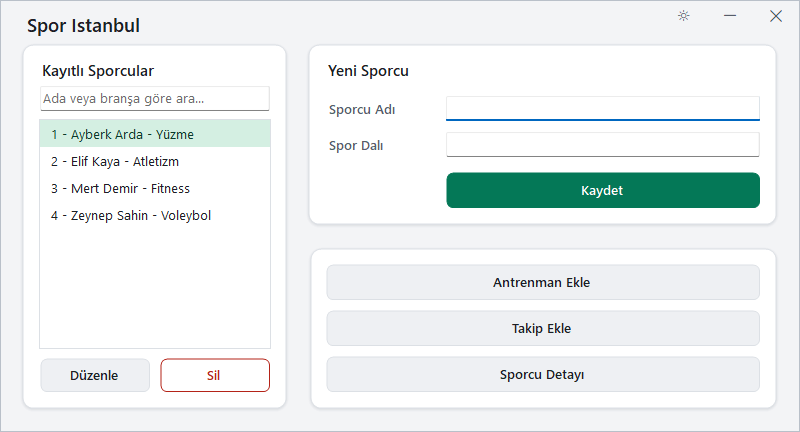
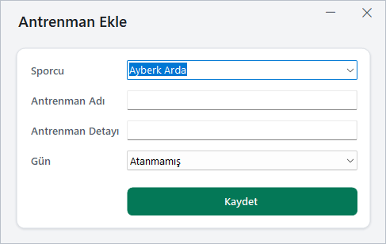
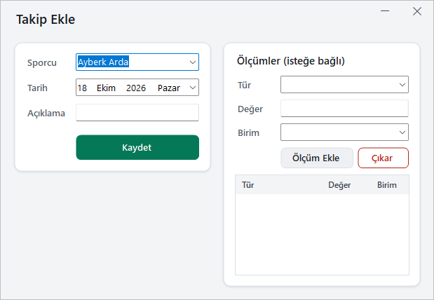
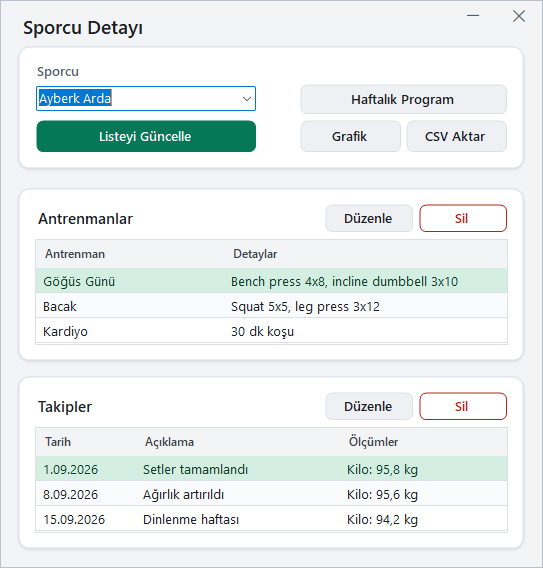

# 🏋️‍♂️ Spor Takip Uygulaması

Bu uygulama, sporcuların antrenman ve gelişim süreçlerini takip etmek amacıyla geliştirilmiş bir masaüstü yazılımıdır. C# Windows Forms ile hazırlanmış olup SQL Server veritabanı kullanmaktadır.

## 🚀 Kurulum

**Gereksinimler**

- Windows 10 sürüm 2004 (build 19041) veya üstü, ya da Windows 11. Arayüz projesi `net10.0-windows10.0.19041.0` hedefler; grafik bileşeni bu sürümü istiyor.
- [.NET 10 SDK](https://dotnet.microsoft.com/download)
- SQL Server LocalDB (Visual Studio ile gelir) veya SQL Server Express

1. **Veritabanı**  
   Elle bir şey yapmanız gerekmez. Program her açılışta bağlantı ayarındaki veritabanını yoksa oluşturur ve eksik şema betiklerini sırayla uygular (`SchemaMigrator`). Uygulanan betikler veritabanındaki `SchemaVersion` tablosuna yazılır, bir sonraki açılışta tekrar çalışmaz. İşlem uzun sürerse kısa bir "Veritabanı hazırlanıyor" penceresi görünür; sunucuya ulaşılamazsa hata günlüğe yazılır ve bir uyarıdan sonra program yine açılır.

   Otomatik uygulanan betikler:

   - `database\001_initial.sql`: tablolar
   - `database\002_cascade_fk.sql`: sporcu silinince kayıtlarının da silinmesi
   - `database\003_olcumler.sql`: takip kayıtlarına bağlı ölçümler
   - `database\004_butunluk.sql`: veri bütünlüğü kuralları ve antrenmanlara gün alanı

   **Alternatif: betikleri elle çalıştırma**  
   İsterseniz aynı betikleri `sqlcmd` ile kendiniz de uygulayabilirsiniz. Komutları proje kök klasöründe çalıştırın:

   ```bat
   sqlcmd -S "(localdb)\MSSQLLocalDB" -Q "CREATE DATABASE SporTakip"
   sqlcmd -S "(localdb)\MSSQLLocalDB" -d SporTakip -i database\001_initial.sql
   sqlcmd -S "(localdb)\MSSQLLocalDB" -d SporTakip -i database\002_cascade_fk.sql
   sqlcmd -S "(localdb)\MSSQLLocalDB" -d SporTakip -i database\003_olcumler.sql
   sqlcmd -S "(localdb)\MSSQLLocalDB" -d SporTakip -i database\004_butunluk.sql
   ```

   Örnek veri isterseniz (isteğe bağlı, otomatik çalışmaz):

   ```bat
   sqlcmd -S "(localdb)\MSSQLLocalDB" -d SporTakip -i database\seed.sql
   ```

   Betikler tekrar çalıştırılabilir; var olan tablo ve kayıtlara dokunmaz.

2. **Bağlantı Ayarı**  
   Varsayılan bağlantı `src\SporTakip.WinForms\appsettings.json` içindedir ve LocalDB'yi kullanır. Kendi SQL Server'ınızı kullanacaksanız aynı klasöre `appsettings.Local.json` dosyası açın (git'e eklenmez, varsa varsayılanı ezer):

   ```json
   {
     "ConnectionStrings": {
       "SporTakip": "Server=.\\SQLEXPRESS;Database=SporTakip;Integrated Security=True;TrustServerCertificate=True;"
     }
   }
   ```

3. **Programı Çalıştırma**  
   Visual Studio ile `SporTakip.sln` dosyasını açıp başlatabilir ya da komut satırından çalıştırabilirsiniz:

   ```bat
   dotnet run --project src\SporTakip.WinForms
   ```

**Alternatif: Yedekten Yükleme**  
Eski yöntemle, proje klasöründeki `SporTakip.bak` dosyasını kendi SQL Server sunucunuza **restore** edebilirsiniz. Eksik betikler program ilk açıldığında otomatik uygulanır; elle yapmak isterseniz `database\002_cascade_fk.sql`, `database\003_olcumler.sql` ve `database\004_butunluk.sql` betiklerini sırayla çalıştırın.

---

## 🛠️ Geliştirme

**Çözüm yapısı**

```
src/
  SporTakip.Domain/        Varlıklar (Sporcu, Antrenman, Takip, Olcum)
  SporTakip.Application/   Servisler ve doğrulama kuralları
  SporTakip.Data/          Dapper ile SQL Server repository'leri
  SporTakip.WinForms/      Arayüz, DI ve appsettings.json
tests/
  SporTakip.Application.Tests/   Servis birim testleri
  SporTakip.Data.Tests/          Repository entegrasyon testleri
database/                  Şema ve örnek veri betikleri
```

**Katmanlar ve bağımlılık yönü**

```
WinForms ──> Application ──> Domain
   │              ▲
   └──> Data ─────┘ (Application arayüzlerini uygular)
```

**Derleme ve test**

```bat
dotnet build
dotnet test
```

Entegrasyon testleri (`SporTakip.Data.Tests`) yalnızca `SPORTAKIP_TEST_CONNECTION` ortam değişkeni tanımlıysa çalışır, yoksa atlanır. Testler bu sunucuda geçici bir veritabanı açar, şema betiklerini uygular ve sonunda siler:

```bat
set SPORTAKIP_TEST_CONNECTION=Server=(localdb)\MSSQLLocalDB;Integrated Security=True;TrustServerCertificate=True;
dotnet test
```

---

## 👤 Sporcu Ekleme

1. `Sporcu Adı` kısmına adı yazın (örn: **Ayberk Arda**)  
2. `Spor Dalı` kısmına branşı yazın (örn: **Yüzme**)  
3. `Kaydet` butonuna basın  
4. Sporcu listede görünür

**Arama, düzenleme ve silme**

- Listenin üstündeki arama kutusuna yazdıkça sporcular ada veya branşa göre süzülür. `Enter` aramayı hemen yapar, `Esc` kutuyu temizler.
- Sporcuyu düzenlemek için listeden seçip `Düzenle` butonuna basın ya da sporcuya çift tıklayın.
- `Sil` butonu sporcuyu, onay alındıktan sonra ona ait tüm antrenman ve takip kayıtlarıyla birlikte siler.

---

## 🏃‍♂️ Antrenman Ekleme

1. Ana ekranda `Antrenman Ekle` butonuna tıklayın  
2. Açılan pencerede:  
   - Sporcu listesinden birini seçin  
   - Antrenman adını girin (örn: **Göğüs Günü**)  
   - Detaylarını yazın (örn: **Chest Press, Incline Dumbbell Press**)  
   - İsterseniz `Gün` listesinden haftanın bir gününü seçin (boş bırakılırsa **Atanmamış** kalır)  
3. `Kaydet` butonuna tıklayın

Var olan bir antrenmanın gününü değiştirmek için `Sporcu Detayı` ekranında antrenmanı seçip `Düzenle` butonuna basın ve `Gün` alanını değiştirin.

---

## 📅 Takip Kaydı Ekleme

1. Ana ekranda `Takip Ekle` butonuna tıklayın  
2. Açılan formda:  
   - Sporcu seçin  
   - Takip tarihini belirleyin  
   - Açıklama girin (örn: **Setler tamamlandı**)  
3. İsterseniz `Ölçümler (isteğe bağlı)` bölümünden ölçüm ekleyin:  
   - `Tür` (örn: **Kilo**), `Değer` (örn: **95** ya da **72,5**) ve `Birim` (örn: **kg**) girin  
   - `Ölçüm Ekle` butonuna basın (ölçüm kutularındayken `Enter` de ekler); yanlış eklenen satırı seçip `Çıkar` ile kaldırın  
4. `Kaydet` butonuna tıklayın

Kaydedilmiş bir takibin ölçümleri `Sporcu Detayı` ekranında takip seçilip `Düzenle` ile açılan pencerede eklenebilir, güncellenebilir veya silinebilir.

---

## 📊 Sporcu Geçmişi Görüntüleme

1. Ana ekranda `Sporcu Detayı` butonuna tıklayın  
2. Açılan formda:  
   - Sporcu seçin  
   - Seçilen sporcuya ait antrenmanlar ve takip kayıtları listelenir  
   - İsteğe bağlı olarak `Listeyi Güncelle` butonuna basarak verileri yenileyebilirsiniz

**Antrenman ve takip kayıtlarını düzenleme / silme**

- Bir kaydı düzenlemek için tablodan seçip altındaki `Düzenle` butonuna basın ya da satıra çift tıklayın. Antrenmanda ad ve detaylar, takipte tarih ve açıklama değiştirilebilir.
- Silmek için kaydı seçip `Sil` butonuna basın ya da `Delete` tuşunu kullanın; silmeden önce onay istenir.

**Ölçüm grafiği**

1. `Sporcu Detayı` ekranında sporcuyu seçip `Grafik` butonuna basın  
2. `Ölçüm türü` listesinden bir tür seçin (örn: **Kilo**); o türün değerleri tarihe göre çizgi grafik olarak gösterilir  

**CSV raporu**

1. `Sporcu Detayı` ekranında sporcuyu seçip `CSV Aktar` butonuna basın  
2. Dosyanın kaydedileceği yeri seçin  

Dosya `;` ayırıcılı ve UTF-8 (BOM'lu) yazılır; Türkçe Excel'de çift tıklayınca sütunlar ve Türkçe karakterler doğru açılır. Ölçümlü takipler her ölçüm için ayrı satırda yer alır.

**Haftalık program**

1. `Sporcu Detayı` ekranında sporcuyu seçip `Haftalık Program` butonuna basın  
2. Antrenmanlar Pazartesi'den Pazar'a gün kartlarında listelenir; güne atanmamış antrenmanlar altta ayrı bir şeritte gösterilir  

**Klavye**

Pencerelerde `Tab` kontroller arasında soldan sağa, yukarıdan aşağıya ilerler. `Enter` kaydeder; diyalog pencereleri `Esc` ile kapanır. Ana ekranda `Esc` programı kapatmaz.

---

## 🎨 Tema

Uygulamada **Açık** ve **Koyu** olmak üzere iki tema var. Ana ekranın sağ üstündeki tema düğmesinden `Sistem teması`, `Açık` veya `Koyu` seçilebilir; seçim açık pencerelerin hepsine hemen uygulanır.

- Seçim `%LOCALAPPDATA%\SporTakip\tema.json` dosyasına yazılır ve sonraki açılışlarda kullanılır.
- Bu dosya yoksa `src\SporTakip.WinForms\appsettings.json` içindeki `"Tema"` değeri (`Acik`, `Koyu` veya `Sistem`) geçerlidir.
- `Sistem` seçiliyken Windows'un uygulama teması (açık/koyu) izlenir.

Renkler, yazı tipleri ve aralıklar tek yerde, `src\SporTakip.WinForms\Theme\` klasöründe tanımlıdır.

---

## 🖼️ Ekran Görüntüleri

Aşağıdaki görüntüler önceki tasarıma aittir; güncel arayüz yukarıdaki temalarla açılır.

### Ana Sayfa


### Antrenman Ekle


### Takip Kaydı Ekle


### Sporcu Detayı

