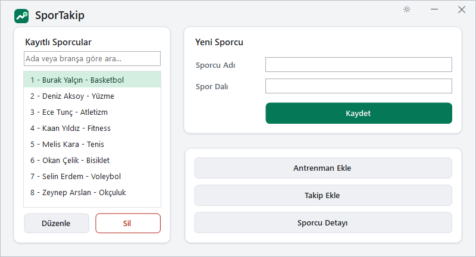
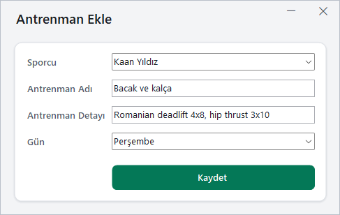
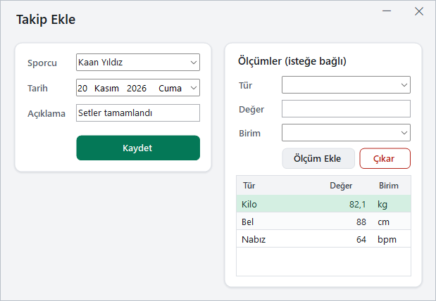
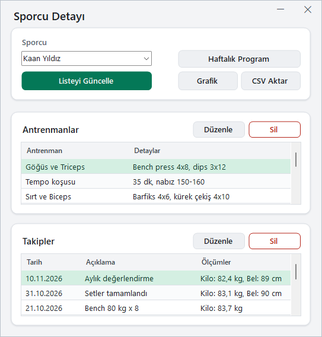
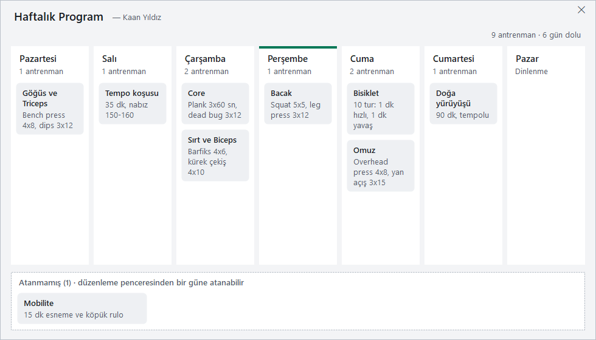
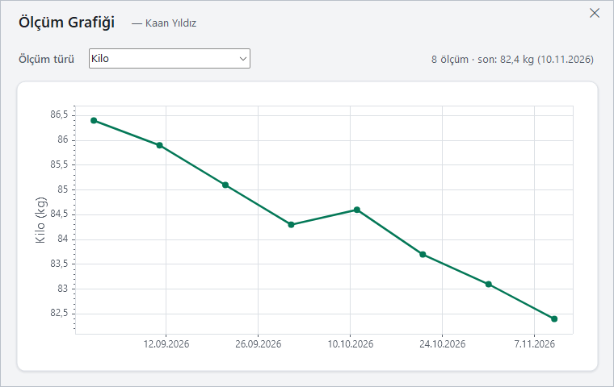

# 🏋️‍♂️ Spor Takip - Sports Tracking Application

🇬🇧 **English** · 🇹🇷 [Türkçe](README.tr.md)

A desktop application for tracking athletes' training and progress. It is built with C# Windows Forms and uses a SQL Server database.

The user interface is in Turkish. In this document the on-screen labels are written as `Turkish label` followed by the English meaning in parentheses where it helps.

## 🚀 Setup

**Requirements**

- Windows 10 version 2004 (build 19041) or later, or Windows 11. The UI project targets `net10.0-windows10.0.19041.0`; the chart component needs this version.
- [.NET 10 SDK](https://dotnet.microsoft.com/download)
- SQL Server LocalDB (ships with Visual Studio) or SQL Server Express

1. **Database**  
   You do not have to do anything by hand. On every start the program creates the database named in the connection setting if it does not exist, and applies the missing schema scripts in order (`SchemaMigrator`). Applied scripts are recorded in the `SchemaVersion` table and are not run again on the next start. If this takes a while, a short "Veritabanı hazırlanıyor" (preparing the database) window appears; if the server cannot be reached, the error is written to the log and the program still opens after a warning.

   Scripts applied automatically:

   - `database\001_initial.sql`: tables
   - `database\002_cascade_fk.sql`: deleting an athlete also deletes their records
   - `database\003_olcumler.sql`: measurements attached to follow-up records
   - `database\004_butunluk.sql`: data integrity rules and a day field on workouts

   **Alternative: run the scripts by hand**  
   You can also apply the same scripts yourself with `sqlcmd`. Run the commands in the project root folder:

   ```bat
   sqlcmd -S "(localdb)\MSSQLLocalDB" -Q "CREATE DATABASE SporTakip"
   sqlcmd -S "(localdb)\MSSQLLocalDB" -d SporTakip -i database\001_initial.sql
   sqlcmd -S "(localdb)\MSSQLLocalDB" -d SporTakip -i database\002_cascade_fk.sql
   sqlcmd -S "(localdb)\MSSQLLocalDB" -d SporTakip -i database\003_olcumler.sql
   sqlcmd -S "(localdb)\MSSQLLocalDB" -d SporTakip -i database\004_butunluk.sql
   ```

   Sample data (optional, never runs automatically):

   ```bat
   sqlcmd -S "(localdb)\MSSQLLocalDB" -d SporTakip -i database\seed.sql
   ```

   The scripts can be run again; they do not touch existing tables and records.

2. **Connection setting**  
   The default connection is in `src\SporTakip.WinForms\appsettings.json` and uses LocalDB. To use your own SQL Server, create an `appsettings.Local.json` file in the same folder (it is not added to git and overrides the default when present):

   ```json
   {
     "ConnectionStrings": {
       "SporTakip": "Server=.\\SQLEXPRESS;Database=SporTakip;Integrated Security=True;TrustServerCertificate=True;"
     }
   }
   ```

3. **Running the program**  
   Open `SporTakip.sln` in Visual Studio and start it, or run it from the command line:

   ```bat
   dotnet run --project src\SporTakip.WinForms
   ```

**Existing databases**  
The repository no longer ships a database backup (`.bak`); a new database is created from the scripts in `database\`. If you already have an older SporTakip database, point the connection string at it: the missing scripts are applied automatically when the program first starts; to do it by hand, run `database\002_cascade_fk.sql`, `database\003_olcumler.sql` and `database\004_butunluk.sql` in order.

---

## 🛠️ Development

**Solution structure**

```
src/
  SporTakip.Domain/        Entities (Sporcu, Antrenman, Takip, Olcum)
  SporTakip.Application/   Services and validation rules
  SporTakip.Data/          SQL Server repositories with Dapper
  SporTakip.WinForms/      UI, DI and appsettings.json
tests/
  SporTakip.Application.Tests/   Service unit tests
  SporTakip.Data.Tests/          Repository integration tests
database/                  Schema and sample data scripts
```

**Layers and dependency direction**

```
WinForms ──> Application ──> Domain
   │              ▲
   └──> Data ─────┘ (implements the Application interfaces)
```

**Build and test**

```bat
dotnet build
dotnet test
```

The integration tests (`SporTakip.Data.Tests`) only run when the `SPORTAKIP_TEST_CONNECTION` environment variable is set; otherwise they are skipped. The tests create a temporary database on that server, apply the schema scripts and drop it at the end:

```bat
set SPORTAKIP_TEST_CONNECTION=Server=(localdb)\MSSQLLocalDB;Integrated Security=True;TrustServerCertificate=True;
dotnet test
```

---

## 👤 Adding an athlete

1. Type the name into `Sporcu Adı` (athlete name), for example **Ayberk Arda**  
2. Type the sport into `Spor Dalı` (sport), for example **Yüzme** (swimming)  
3. Press the `Kaydet` (save) button  
4. The athlete appears in the list

**Search, edit and delete**

- Typing into the search box above the list filters athletes by name or sport. `Enter` searches immediately, `Esc` clears the box.
- To edit an athlete, select them in the list and press `Düzenle` (edit), or double-click the athlete.
- `Sil` (delete) removes the athlete after a confirmation, together with all their workouts and follow-up records.

---

## 🏃‍♂️ Adding a workout

1. Click `Antrenman Ekle` (add workout) on the main screen  
2. In the window that opens:  
   - Pick an athlete from the list  
   - Enter the workout name, for example **Göğüs Günü** (chest day)  
   - Write the details, for example **Chest Press, Incline Dumbbell Press**  
   - Optionally pick a weekday from the `Gün` (day) list (if left empty it stays **Atanmamış**, unassigned)  
3. Click `Kaydet`

To change the day of an existing workout, select it on the `Sporcu Detayı` (athlete details) screen, press `Düzenle` and change the `Gün` field.

---

## 📅 Adding a follow-up record

1. Click `Takip Ekle` (add follow-up) on the main screen  
2. In the form that opens:  
   - Pick an athlete  
   - Set the follow-up date  
   - Enter a description, for example **Setler tamamlandı** (sets completed)  
3. Optionally add measurements in the `Ölçümler (isteğe bağlı)` (measurements, optional) section:  
   - Enter `Tür` (type, for example **Kilo**, weight), `Değer` (value, for example **95** or **72,5**) and `Birim` (unit, for example **kg**)  
   - Press `Ölçüm Ekle` (add measurement); `Enter` also adds it while you are in the measurement boxes. Select a wrongly added row and remove it with `Çıkar` (remove)  
4. Click `Kaydet`

Measurements of a saved follow-up can be added, updated or deleted in the window opened by selecting the follow-up on the `Sporcu Detayı` screen and pressing `Düzenle`.

---

## 📊 Viewing an athlete's history

1. Click `Sporcu Detayı` on the main screen  
2. In the form that opens:  
   - Pick an athlete  
   - The workouts and follow-up records of the selected athlete are listed  
   - Optionally press `Listeyi Güncelle` (refresh list) to reload the data

**Editing and deleting workouts and follow-up records**

- To edit a record, select it in the table and press the `Düzenle` button under it, or double-click the row. For a workout the name and details can be changed, for a follow-up the date and description.
- To delete, select the record and press `Sil` or use the `Delete` key; a confirmation is asked before deleting.

**Measurement chart**

1. On the `Sporcu Detayı` screen select the athlete and press `Grafik` (chart)  
2. Pick a type from the `Ölçüm türü` (measurement type) list, for example **Kilo**; the values of that type are drawn as a line chart by date  

**CSV report**

1. On the `Sporcu Detayı` screen select the athlete and press `CSV Aktar` (export CSV)  
2. Choose where to save the file  

The file is written with `;` as the separator and in UTF-8 with a BOM, so columns and Turkish characters open correctly when you double-click it in Turkish Excel. Follow-ups with measurements appear on a separate row for each measurement.

**Weekly program**

1. On the `Sporcu Detayı` screen select the athlete and press `Haftalık Program` (weekly program)  
2. Workouts are listed on day cards from Monday to Sunday; workouts not assigned to a day are shown in a separate strip at the bottom  

**Keyboard**

In the windows, `Tab` moves between controls from left to right and top to bottom. `Enter` saves; dialog windows close with `Esc`. On the main screen `Esc` does not close the program.

---

## 🎨 Theme

The application has two themes: **Light** (`Açık`) and **Dark** (`Koyu`). The theme button at the top right of the main screen offers `Sistem teması` (system theme), `Açık` or `Koyu`; the choice is applied immediately to all open windows.

- The choice is written to `%LOCALAPPDATA%\SporTakip\tema.json` and used on the next starts.
- If this file does not exist, the `"Tema"` value in `src\SporTakip.WinForms\appsettings.json` (`Acik`, `Koyu` or `Sistem`) applies.
- While `Sistem` is selected, the Windows app theme (light or dark) is followed.

Colors, fonts and spacing are defined in one place, the `src\SporTakip.WinForms\Theme\` folder.

---

## 🖼️ Screenshots

The images were taken with the light theme and sample data.

### Main screen


### Add workout


### Add follow-up record


### Athlete details


### Weekly program


### Measurement chart


## License

Released under the [MIT License](LICENSE).
